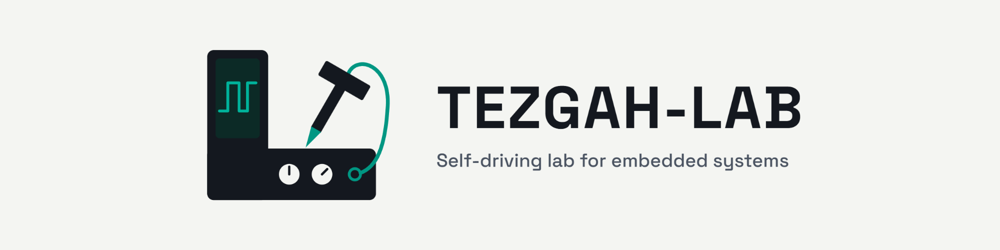

<picture>
  <source media="(prefers-color-scheme: dark)" srcset="assets/banner-dark.png">
  
</picture>

*Tezgah* is Turkish for workbench. This is the umbrella repo for a hardware-in-the-loop test setup for
STM32 boards that a person or a coding agent can drive from the command line. Every command returns a
machine-readable verdict with the likely causes of a failure, and every test has to show that it can
fail: each one is also run against something deliberately broken, and must catch it.

The work lives in three repos, included here as git submodules. Each one stands on its own, with its
code, data, figures and README:

| Repo | What it is | Headline result |
|---|---|---|
| [**c031-ab-bootloader-stress**](https://github.com/aarmert/c031-ab-bootloader-stress) | An A/B bootloader for the NUCLEO-C031C6, reset at thousands of planned moments during a firmware update, from inside the chip and by an ESP32-S3 pulling NRST | **0 failures in 3103 trials** (95% upper bound 0.097%). The naive bootloader, as the negative control, booted a corrupt image in 11 of 20. |
| [**f407-hil-bench**](https://github.com/aarmert/f407-hil-bench) | `bench.py`: flash, reset, serial, TOML test plans and self-recovery for the STM32F407 Discovery, plus its test firmware | `smoke`, `crash_recovery`, `measure` and `camera_blink` pass on the real board, and each FAILS when broken on purpose |
| [**f407-camera-blink**](https://github.com/aarmert/f407-camera-blink) | Measuring an LED's blink frequency and duty cycle with a phone camera, frame by frame, and checking it against the board's own clock | 0.995 / 1.985 / 4.007 Hz for commanded 1 / 2 / 4 Hz; the board clock runs 0.5% slow |

## Getting it

```bash
git clone --recurse-submodules https://github.com/aarmert/tezgah-lab.git tezgah
# or, in an existing clone:
git submodule update --init
```

Or clone just the repo you need. Each has its own `pyproject.toml` (run things with
[uv](https://docs.astral.sh/uv/)) and a "try it without hardware" section in its README.

## How the repos fit together

```
tezgah/
├── f407-hil-bench/              bench.py, plans, F407 test firmware
├── c031-ab-bootloader-stress/   stress tool + bootloaders + ESP32 bridge (includes a copy of bench.py)
└── f407-camera-blink/           blinkmeter + the phone camera tool (camera/)
```

- `bench.py` is maintained in **f407-hil-bench**. c031-ab-bootloader-stress carries an unchanged copy
  because its stress tool imports it for flashing, SWD read-back and serial.
- The phone camera tool is maintained in **f407-camera-blink** (`camera/`). f407-hil-bench's
  `cam_blink` step uses it through a local `camera/` link to the sibling folder.
- The F407 test firmware (`BLINK`, `TICK`, `LED` …) is in **f407-hil-bench**; f407-camera-blink uses
  the same firmware.

## Working on it

Make changes and commit inside the submodule they belong to, then commit the new submodule pointer
here. When publishing, push the three submodules first and this repo last, so the pointers resolve.

A coding agent should start in the submodule it works on; the bench rules are in that repo's
`AGENTS.md`. This folder's [`AGENTS.md`](AGENTS.md) only says where things are.

## License

Apache License 2.0, see [LICENSE](LICENSE). The same license applies in each submodule.
